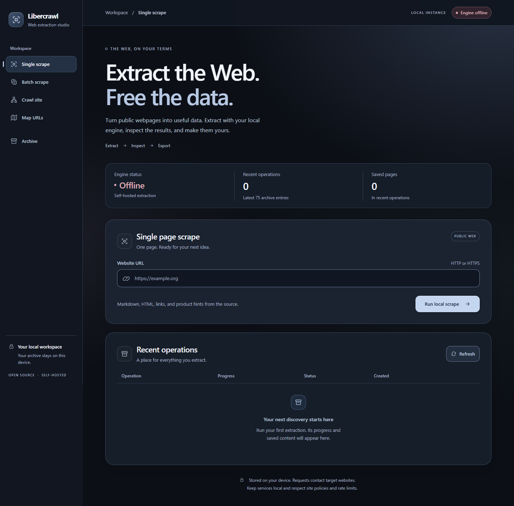
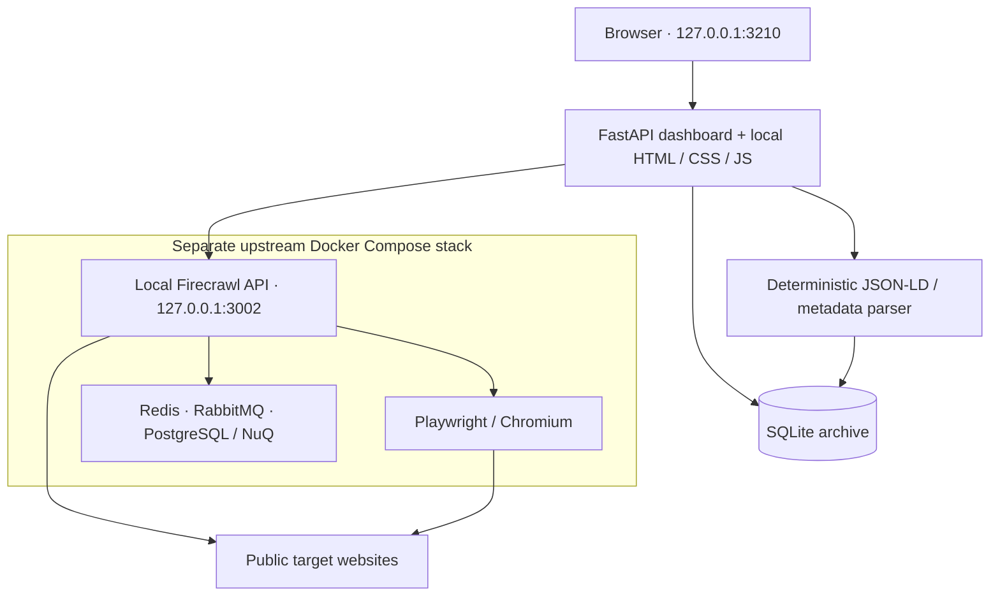

<div align="center">

# Libercrawl

### Extract the Web. Free the data.

A local-first web extraction workspace for developers and researchers.

**Self-hosted · SQLite archive · JSON / JSONL / Markdown / CSV**

[Get started](#installation) · [Features](#features) · [Architecture](#architecture) · [Documentation](#documentation)

</div>



<p align="center"><sub>Actual public dashboard running in an isolated local environment. Empty archive; extraction engine offline. <a href="docs/assets/README.md">Screenshot provenance</a>.</sub></p>

Libercrawl brings single-page scraping, bounded crawls, URL discovery, and saved results into one browser interface. A Python/FastAPI application manages jobs and a local SQLite archive; a separately installed **[Firecrawl extraction engine](THIRD_PARTY_NOTICES.md)** fetches the pages through Docker Compose.

The public edition uses no hosted scraping account, API credits, or cloud AI for its normal workflows. Its frontend uses vanilla HTML, CSS, JavaScript, and system fonts, with no CDN assets or tracking scripts. Installation downloads dependencies, and extraction contacts target websites: **local-first does not mean offline**.

## Features

| Workflow | Public-edition behavior |
| --- | --- |
| **Single scrape** | Extract one public HTTP/HTTPS page; retain available Markdown, HTML, links, and metadata. |
| **Batch scrape** | Process a deduplicated URL list sequentially inside one job; retain successful pages and report failures. Default cap: 30 URLs. |
| **Crawl site** | Request a crawl with page and discovery-depth limits, poll progress, and offer cancellation. Form defaults: 10 pages, depth 2; default backend cap: 50 pages. |
| **Map URLs** | Discover URLs without archiving page bodies. Default request: 30 links; request limit: 250. |
| **Archive & Inspect** | Review saved operations, page previews, product-field candidates, progress, and errors. The list shows the latest 75 jobs. |
| **Product hints** | Parse Product/ProductGroup JSON-LD and HTML metadata locally, with provenance and missing-field indicators. No LLM is used to fill gaps. |

Product hints are **best-effort candidates**. Prices, sizes, variants, and other fields depend on what the source supplies and need verification. This dashboard does not provide AI extraction, CAPTCHA bypass, or guaranteed access to every website.

### Export formats

Downloads are available from **Archive → Inspect**.

| Format | Contents | Supported jobs |
| --- | --- | --- |
| **JSON** (`.json`) | Job record and stored pages, including HTML, Markdown, metadata, links, and product candidates; map URLs live in the job's `links` array. | All |
| **JSONL** (`.jsonl`) | One stored page object per line. | Scrape, batch, crawl |
| **Markdown** (`.md`) | Page titles, source URLs, and stored Markdown, separated into one document. | Scrape, batch, crawl |
| **CSV** (`.csv`) | Product-oriented columns: URL, name, brand, SKU, price, currency, sizes, colors, material, and missing fields. | Scrape, batch, crawl |

CSV is a candidate-data export, not a verified product catalog. HTML is included in stored page records and JSON/JSONL exports; there is no standalone HTML download. See the [user guide](docs/USER_GUIDE.md) for content caps and preview limits.

## Requirements

The extraction engine runs several containers, including a browser service. These are **planning estimates**, not benchmarked minimums or performance guarantees.

| Resource | To try the stack | Recommended |
| --- | --- | --- |
| **OS** | 64-bit Linux, or Windows with WSL2 Ubuntu | Supported Ubuntu LTS; Windows 11 + WSL2 Ubuntu |
| **CPU** | 2 modern x86-64 cores | 4+ cores |
| **RAM** | 8 GB; builds or workloads may fail | 16 GB+ available to the workload, allowing for the host OS |
| **Free disk** | 30 GB before the first build | 50 GB+ for images, builds, logs, and archives |
| **GPU** | Not required | Not required |
| **Tools** | Git, Python 3 with `venv`/pip, Docker Engine, Docker Compose v2, a modern browser | Internet access for installation and target websites |

Linux/WSL2 is the documented setup. Native Windows PowerShell scripts are included but have not been equivalently validated; macOS and ARM deployments are unverified. The recommended WSL2 path runs Docker Engine inside Ubuntu and does not require Docker Desktop. Windows 10 users should review the [support and ESU guidance](docs/INSTALL.md#install-with-windows--wsl2).

## Installation

### Windows with WSL2

In **PowerShell as Administrator**, install Ubuntu if WSL is not already set up:

```powershell
wsl --install -d Ubuntu
```

Restart if prompted and complete Ubuntu's first-run user setup. In **PowerShell**, verify that Ubuntu uses WSL version **2**, then open it:

```powershell
wsl -l -v
wsl -d Ubuntu
```

If Ubuntu is listed as version 1, run `wsl --set-version Ubuntu 2` first. Follow the Linux steps below **inside Ubuntu**. Keep the checkout under `~/libercrawl` for Linux filesystem performance. See the [full WSL2 guide](docs/INSTALL.md#install-with-windows--wsl2) and [Microsoft's installation instructions](https://learn.microsoft.com/en-us/windows/wsl/install).

### Linux / Ubuntu

On a fresh supported Ubuntu installation, install prerequisites:

```bash
sudo apt update
sudo apt install -y git curl docker.io docker-compose-v2 python3 python3-venv python3-pip
sudo systemctl enable --now docker
docker compose version
docker ps
```

Package availability varies by Ubuntu release. If Compose v2 is unavailable, follow [Docker's Ubuntu instructions](https://docs.docker.com/engine/install/ubuntu/); avoid mixing Docker package sources. If `docker ps` reports a permissions error, complete [Docker permissions](docs/INSTALL.md#2-docker-permissions) before continuing. The `docker` group grants root-equivalent access. WSL2 also needs systemd enabled; see [troubleshooting](docs/TROUBLESHOOTING.md#docker-daemon-is-not-running-under-wsl2).

Clone and install:

```bash
cd ~
git clone https://github.com/crsalass/libercrawl.git
cd libercrawl
bash scripts/install.sh
bash scripts/start.sh
```

The installer downloads and checks the pinned engine source, applies its documented compatibility patch, creates local configuration and a Python environment, and installs dashboard dependencies. The start script builds and launches the engine containers, then runs the dashboard in the foreground. The first build can take substantial time and disk space.

Open **[127.0.0.1:3210](http://127.0.0.1:3210)**. The extraction API is configured at `http://127.0.0.1:3002`. Keep both services restricted to loopback.

### Verify your first extraction

1. Wait for **Engine online** in the dashboard.
2. In **Single scrape**, submit `https://example.org`.
3. Open **Archive → Inspect** for the completed job and check its extracted content.
4. Download JSON or Markdown and review the result.

For diagnostics, run `curl -s http://127.0.0.1:3210/api/status` in another Ubuntu terminal. **Online only confirms API responsiveness**: the health probe deliberately sends an empty scrape request and expects HTTP 400/422. A completed scrape is the end-to-end check.

### Stop and restart

Press `Ctrl+C` in the dashboard terminal, then stop the engine containers:

```bash
bash scripts/stop.sh
```

The SQLite archive is retained. Start again with `bash scripts/start.sh`; builds reuse cached layers where possible. Unfinished dashboard jobs do not resume after a restart.

## Architecture



The dashboard and extraction engine are separate services. Job creation returns **HTTP 202** and records a queued operation in SQLite. In-process async workers run at most **two jobs** at once; batches fetch URLs sequentially, while crawls poll the upstream job. Available page data is archived before inspection or export. SQLite uses WAL mode and per-job URL deduplication.

The installer pins Firecrawl **`v2.11.0`**, commit **`ef12eb36b2f3382838dfe0a0c1a5add3d5df7fe5`**, rather than following upstream `main`. It selects PostgreSQL for NuQ (`NUQ_BACKEND=pg`); FoundationDB services are also present in the pinned Compose file. A shared patcher adjusts RabbitMQ's health-check user and startup timings. See [architecture and configuration](docs/ARCHITECTURE.md) and [upstream attribution](THIRD_PARTY_NOTICES.md).

### Configuration

Installation copies [`.env.example`](.env.example) to the dashboard's `.env`. The extraction engine has a separate `engine/.env`.

| Dashboard setting | Default | Effective constraint |
| --- | --- | --- |
| `LOCAL_ENGINE_URL` | `http://127.0.0.1:3002` | HTTP on `localhost`, `127.0.0.1`, or `::1`, with an explicit port |
| `APP_DATA_DIR` | `./data` | Stores `embercrawl.sqlite3`; legacy filename retained for compatibility |
| `MAX_BATCH_URLS` | `30` | Clamped to 1–100 URLs per batch |
| `MAX_CRAWL_PAGES` | `50` | Backend cap clamped to 1–250; the UI permits up to 50 |
| `MAX_JOB_SECONDS` | `900` | Clamped to 60–3,600 seconds per job |

Both start scripts explicitly bind Uvicorn to **`127.0.0.1:3210`**. Changing `APP_HOST` or `APP_PORT` in `.env` alone does not change that binding. The Docker project name remains `embercrawl-engine` for compatibility with existing installs.

## Security and limitations

**Use Libercrawl as a trusted local tool.** The dashboard has no login, and the default extraction API disables database authentication. Neither is designed for public or shared-network exposure.

- **Target checks have limits.** The app accepts public HTTP/HTTPS domain URLs on standard ports and rejects IP targets, embedded credentials, fragments, and common internal addresses. DNS checks do not comprehensively prevent SSRF, redirects, or DNS rebinding; use network isolation for untrusted workloads.
- **Web content and exports are untrusted.** Protect the local archive and backups. Review scraped files before sharing or opening them; CSV values are not sanitized against spreadsheet-formula injection.
- **Scraping uses the network.** Target sites and intermediaries can observe requests. Respect access permissions, site policies, rate limits, and applicable data-handling rules.
- **Jobs are not durable workers.** After a dashboard restart, queued/running records become interrupted. There is no automatic resumption or distributed dashboard queue.
- **Crawl results can be incomplete.** The dashboard does not follow the engine's completed-crawl pagination links. Site restrictions and browser failures can also prevent extraction.
- **Storage and previews are bounded.** Stored HTML and Markdown are each capped at 4 million characters per page; Inspect shows up to 6,000 Markdown characters. The latest-75 archive view is not automatic data deletion.
- **The stack needs deployment review.** The upstream Compose setup is a development baseline. Source pins do not pin every Python dependency or container image; persistence, security updates, and dependency licenses need separate review before production use or binary redistribution.

See [security, privacy, and backups](docs/SECURITY_AND_BACKUPS.md) for the threat model and WAL-safe SQLite backups.

## Development

The public application is small enough to inspect directly:

| Path | Responsibility |
| --- | --- |
| [`app/main.py`](app/main.py) | FastAPI routes, job orchestration, inspection, exports |
| [`app/engine.py`](app/engine.py) · [`app/security.py`](app/security.py) | Local engine client and URL validation |
| [`app/storage.py`](app/storage.py) · [`app/product.py`](app/product.py) | SQLite persistence and deterministic product parsing |
| [`app/static/`](app/static/) | Responsive dark dashboard with local system fonts |
| [`scripts/`](scripts/) · [`tests/`](tests/) | Installation, compatibility patch, and offline regression suite |

To work on the dashboard without installing the extraction engine, use a disposable environment and data directory:

```bash
python3 -m venv .local-backups/dev-venv
source .local-backups/dev-venv/bin/activate
python -m pip install -r requirements-dev.txt
export APP_DATA_DIR="$PWD/.local-backups/dev-data"
python -m pytest -q
node --check app/static/app.js
python -m uvicorn app.main:app --host 127.0.0.1 --port 3210
```

Node.js is needed only for the JavaScript syntax check. The dashboard displays **Engine offline** until a local engine is running. Interactive API documentation is available at `/api/docs` on the dashboard. Tests use fake or mocked engine responses and do not verify a full Docker deployment; run the [first extraction check](#verify-your-first-extraction) after installing the engine.

See [dashboard regression checks](docs/UI_TESTING.md) for the optional isolated browser and accessibility suite.

Read [AGENTS.md](AGENTS.md) before changes. Keep the public edition general-purpose, preserve the minimal frontend, and keep runtime engines, environments, secrets, databases, and scraped data out of source control.

## Documentation

| Guide | Contents |
| --- | --- |
| [Installation](docs/INSTALL.md) | Linux and WSL2 prerequisites, permissions, first run |
| [User guide](docs/USER_GUIDE.md) | Workflows, exports, limits, cancellation |
| [Architecture](docs/ARCHITECTURE.md) | Components, engine pin, configuration boundaries |
| [Troubleshooting](docs/TROUBLESHOOTING.md) | Engine status, Docker, WSL2, browser builds, Inspect |
| [Security & backups](docs/SECURITY_AND_BACKUPS.md) | Local trust model, retention, recovery |
| [Publication review](docs/GITHUB_PUBLISHING.md) | Source hygiene and release checks |

[SHA256SUMS.txt](SHA256SUMS.txt) records source and documentation checksums; it is an integrity manifest, not a signed authenticity guarantee. On Linux/WSL2, verify with `sha256sum -c SHA256SUMS.txt` using checkout bytes without line-ending conversion.

## License and attribution

Libercrawl application source and documentation are offered under **GNU AGPL-3.0-or-later**. See the full [LICENSE](LICENSE) and [license scope](LICENSE_SCOPE.md).

The separately downloaded **[Firecrawl engine](https://github.com/firecrawl/firecrawl/tree/ef12eb36b2f3382838dfe0a0c1a5add3d5df7fe5)** is maintained by its own contributors and retains its upstream licenses and notices. Libercrawl is an independent interface and is not endorsed by the upstream maintainers. [THIRD_PARTY_NOTICES.md](THIRD_PARTY_NOTICES.md) preserves source provenance, version, licenses, and the local compatibility modification; retain these notices in source distributions.

The existing [name-similarity and release-risk review](docs/PRE_PUBLICATION_RISK_REVIEW.md) remains relevant before publication.
